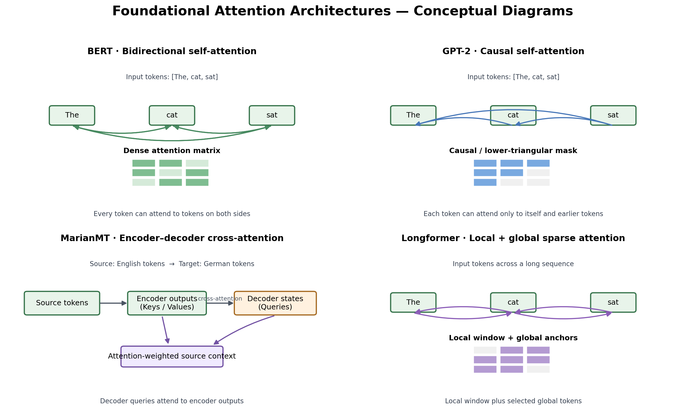
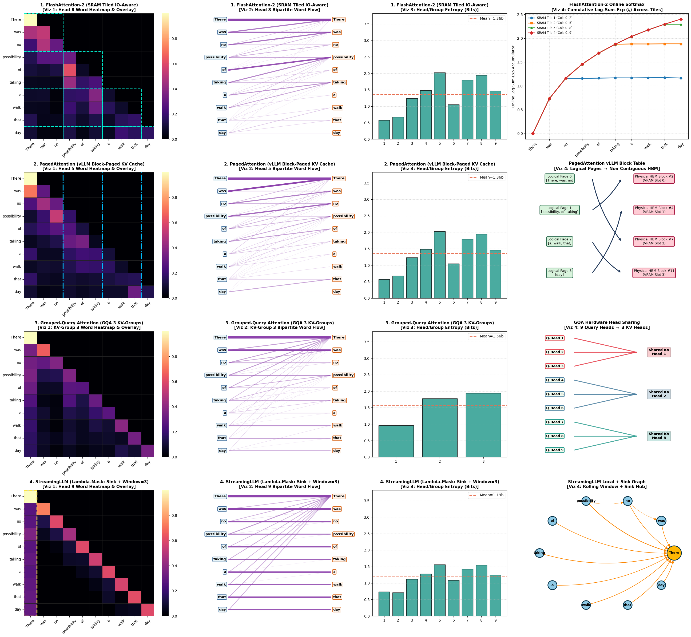
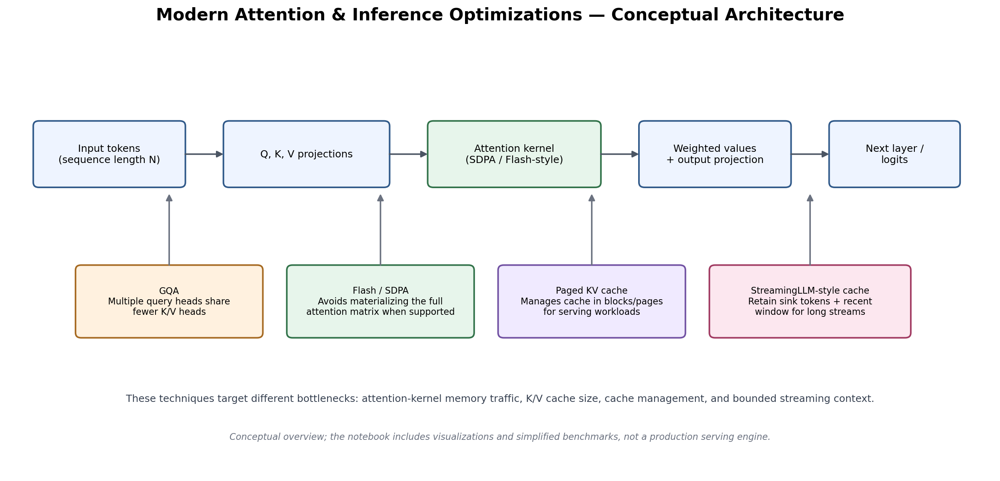
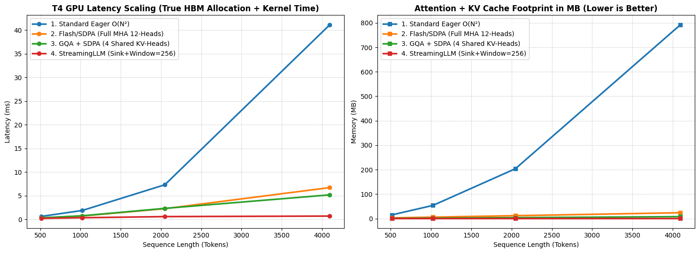

# Attention Mechanisms: Visualization & Performance Benchmarking

Explore how Transformer attention patterns differ across encoder, decoder, encoder–decoder, and long-context models—and how inference optimizations can affect latency and memory. This repository contains a runnable Jupyter notebook, attention visualizations, conceptual architecture diagrams, and a benchmark plot from the notebook's saved execution.



## At a glance

- **Foundational patterns:** BERT bidirectional self-attention, GPT-2 causal self-attention, MarianMT encoder–decoder cross-attention, and Longformer local-plus-global sparse attention.
- **Visualization:** word-level attention heatmaps, alignment/graph views, and a modern-attention systems visualization.
- **Inference concepts:** Flash/SDPA-style attention, grouped-query attention (GQA), paged KV-cache, and StreamingLLM-style sink-plus-window cache.
- **Benchmarking:** a simplified comparison of eager attention, PyTorch scaled-dot-product attention (SDPA), GQA-style KV sizing, and a bounded streaming-cache variant across sequence lengths.
- **Runtime used in the saved notebook output:** Google Colab with an NVIDIA Tesla T4 GPU and FP16 when CUDA is available. Your results may differ on another runtime.

## Repository contents

```text
Attention-Mechanisms-Project/
├── Attention_Mechanisms_Visualization_and_Benchmarking.ipynb
├── README.md
└── assets/
    ├── 01_attention_patterns_comparison.png
    ├── 02_modern_attention_systems.png
    ├── 03_t4_benchmark_results.png
    ├── 04_foundational_architecture_diagrams.png
    └── 05_modern_attention_systems_architecture.png
```

## Visual results

### 1. Attention patterns across model architectures

The saved notebook visualization compares attention maps and related views for four model families. These plots are derived from attention tensors extracted in the notebook; exact patterns depend on the selected sentence, tokenizer, model layer/head, and aggregation method.


### 2. Modern attention and inference concepts

The notebook includes a multi-panel visualization of modern attention and serving concepts. The companion architecture diagram below is a **conceptual schematic**, not a claim that every implementation uses the exact same internal data path.





### 3. Benchmark output

The following figure is the benchmark plot saved in the notebook's existing output. It compares latency and an estimated attention/KV-cache memory footprint for sequence lengths of 512, 1024, 2048, and 4096 tokens.



**How to interpret it:** the eager implementation explicitly constructs the attention score/probability matrix, giving it quadratic intermediate-memory scaling in sequence length. SDPA may use a more memory-efficient kernel when supported by the installed PyTorch build and device. GQA reduces the number of K/V heads in the cache. A fixed-size streaming cache bounds cache storage, but changes the context available to attention. These variants are not identical in semantics, so latency comparisons should be interpreted alongside the implementation details.

> **Reproducibility note:** benchmark numbers are hardware-, software-, warm-up-, and implementation-dependent. The chart is a saved run, not a universal performance guarantee. The benchmark uses simplified tensor workloads and estimated memory formulas; it should not be presented as a production LLM-serving benchmark. Re-run the benchmark cell to produce measurements for your environment before quoting exact values in a report.

## Models and data

The notebook loads a small sample from the `Helsinki-NLP/opus_books` English–German parallel corpus and extracts attention from these pretrained model checkpoints:

| Role | Model checkpoint | Attention pattern illustrated |
|---|---|---|
| Encoder | `google-bert/bert-base-uncased` | Bidirectional self-attention |
| Decoder-only | `openai-community/gpt2` | Causal self-attention |
| Encoder–decoder | `Helsinki-NLP/opus-mt-en-de` | Cross-attention from target to source |
| Long-context encoder | `allenai/longformer-base-4096` | Local attention with selected global positions |

The notebook uses a short English–German sentence pair selected from the dataset sample for visualization. Attention is aggregated from subword tokens to word-level matrices; the plotted values therefore represent a processed view of model attention, not a complete explanation of model behavior.

## Getting started

### Requirements

- Python 3.10+ recommended
- Jupyter Notebook / JupyterLab or Google Colab
- Internet access to download Hugging Face models and dataset
- Optional CUDA GPU for faster inference; the notebook falls back to CPU where possible

### Run in Google Colab

1. Upload `Attention_Mechanisms_Visualization_and_Benchmarking.ipynb` to Google Colab.
2. Select **Runtime → Change runtime type → T4 GPU** (if available).
3. Run cells from top to bottom.
4. Wait for the dataset and model checkpoints to download on the first run.
5. Inspect the generated attention visualizations and benchmark chart.

### Run locally

Create and activate a virtual environment, then install the notebook dependencies:

```bash
python -m venv .venv
# Windows PowerShell
.venv\Scripts\Activate.ps1
# macOS / Linux
# source .venv/bin/activate

python -m pip install --upgrade pip
python -m pip install jupyter torch transformers datasets accelerate matplotlib seaborn networkx scipy pillow
jupyter notebook
```

Open the notebook and run it sequentially. For GPU support, install the PyTorch build appropriate for your CUDA setup from the official [PyTorch installation selector](https://pytorch.org/get-started/locally/).

## Key concepts

- **Self-attention:** tokens build context by weighting other tokens in the same sequence.
- **Causal attention:** masks future positions so a token cannot attend to tokens that come later.
- **Cross-attention:** decoder queries use encoder outputs as keys and values, allowing generated target tokens to focus on source tokens.
- **Sparse/local attention:** restricts most token interactions to a neighborhood, with selected global positions providing wider reach.
- **SDPA / Flash-style attention:** can reduce memory traffic and avoid storing the full attention matrix when a suitable fused kernel is selected.
- **GQA:** shares K/V heads across groups of query heads, reducing K/V cache size compared with multi-head attention with one K/V head per query head.
- **Paged KV cache:** organizes cache storage into blocks to improve allocation and management during serving.
- **Streaming cache:** keeps selected initial “sink” tokens and a recent window instead of retaining every historical token.

## Limitations and responsible interpretation

- Attention weights are useful diagnostics but are not, by themselves, a complete or causal explanation of a model's prediction.
- The Longformer visualization applies a structural local/global mask to the extracted attention matrix for illustration; it should not be mistaken for a faithful visualization of every native Longformer implementation detail.
- The modern systems panels and some benchmark variants are simplified demonstrations of concepts. Paged KV-cache is represented conceptually, not benchmarked with a production paged-attention engine.
- Memory values are estimates from formulas in the notebook and may not include all allocator overhead, temporary buffers, or backend workspace.
- Numerical results vary with GPU model, driver, CUDA/PyTorch versions, precision, batch size, and attention backend.
- Model and dataset licenses/terms apply; check the upstream model and dataset cards before redistributing their assets or outputs.

## Reproducibility checklist

When reporting results, include:

- GPU/CPU model and runtime (for example, Colab Tesla T4)
- Python, PyTorch, Transformers, and CUDA versions
- Model checkpoint IDs and selected layers/heads
- Sequence lengths, precision, warm-up, and number of timed repetitions
- Whether timings are measured kernel latency or end-to-end inference
- Whether memory values are measured peak allocation or analytical estimates

## References

- [Attention Is All You Need](https://arxiv.org/abs/1706.03762)
- [BERT: Pre-training of Deep Bidirectional Transformers](https://arxiv.org/abs/1810.04805)
- [Language Models are Unsupervised Multitask Learners (GPT-2)](https://openai.com/research/better-language-models)
- [Longformer: The Long-Document Transformer](https://arxiv.org/abs/2004.05150)
- [FlashAttention](https://arxiv.org/abs/2205.14135)
- [GQA: Training Generalized Multi-Query Transformer Models from Multi-Head Checkpoints](https://arxiv.org/abs/2305.13245)
- [StreamingLLM: Efficient Streaming Language Models with Attention Sinks](https://arxiv.org/abs/2309.17453)
- [Hugging Face Transformers documentation](https://huggingface.co/docs/transformers/index)
- [PyTorch scaled dot product attention documentation](https://pytorch.org/docs/stable/generated/torch.nn.functional.scaled_dot_product_attention.html)

