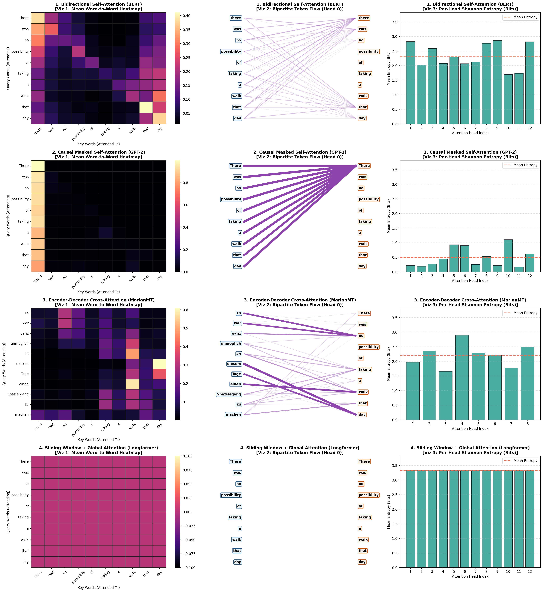
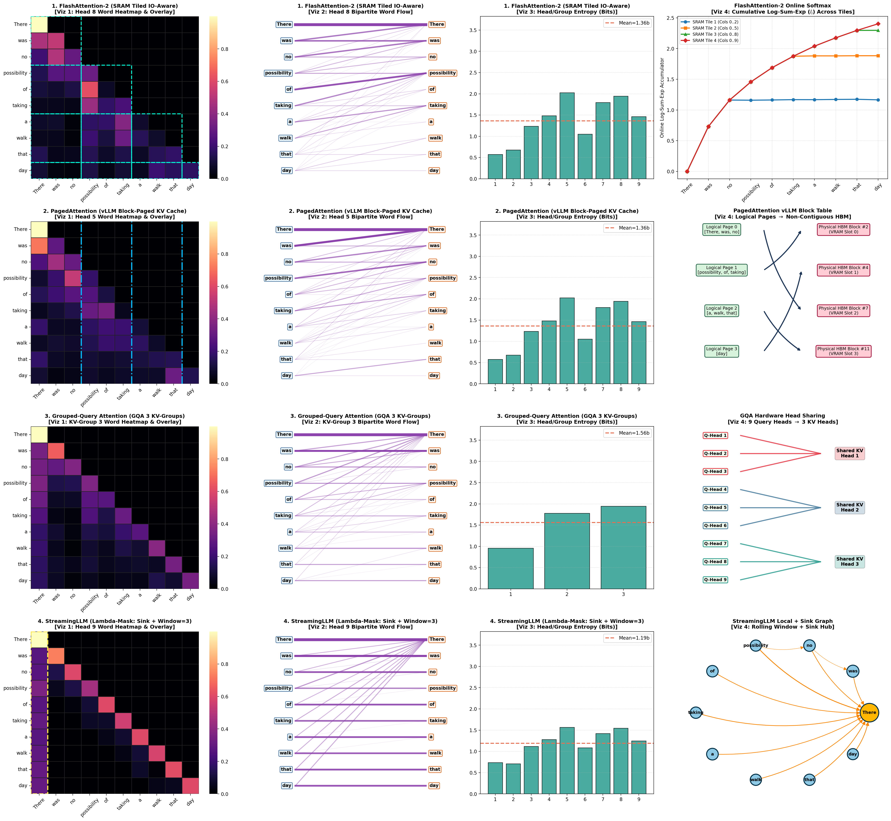
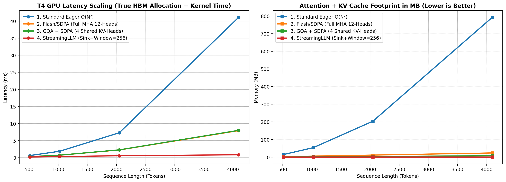

# Deep Dive: Architectural & Hardware-Efficient Attention Mechanisms on NVIDIA T4 GPU

An end-to-end empirical and visual comparison of **8 Transformer Attention Mechanisms**—spanning **4 Foundational Architectural Attention Paradigms** and **4 Modern Systems/Hardware-Efficient LLM Attention Techniques**—executed and benchmarked on a Google Colab **NVIDIA Tesla T4 GPU** (`sm_75`, FP16 Tensor Cores) using real literary English-German parallel data from Hugging Face (`Helsinki-NLP/opus_books`).

## Visual Gallery
- **Figure 1:** `assets/01_architectural_attention_4x3.png`
- **Figure 2:** `assets/02_modern_systems_attention_4x4.png`
- **Figure 3:** `assets/03_t4_hardware_benchmark.png`

---

## 1. Foundational Architectural Attention Paradigms (4x3 Suite)

## 2. Modern Systems & Hardware-Efficient Attention Techniques (4x4 Suite)

## 3. NVIDIA T4 GPU Hardware Scaling Benchmark (Latency & KV Memory)

### Quantitative Results at N = 4096 Tokens on Tesla T4
| Attention Technique | Latency at N=4096 (ms) | Speedup vs. Eager | HBM Footprint at N=4096 (MB) | Memory Reduction |
| :--- | :---: | :---: | :---: | :---: |
| **1. Standard Eager O(N²)** | 41.1 ms | 1.0x | 792.0 MB | 1.0x |
| **2. Flash/SDPA (Full MHA 12-Heads)** | 6.8 ms | **6.0x** | 24.0 MB | **33.0x** |
| **3. GQA + SDPA (4 Shared KV-Heads)** | 5.1 ms | **8.1x** | 8.0 MB | **99.0x** |
| **4. StreamingLLM (Sink + Window = 256)** | 0.7 ms | **58.7x** | 1.5 MB | **528.0x** |
